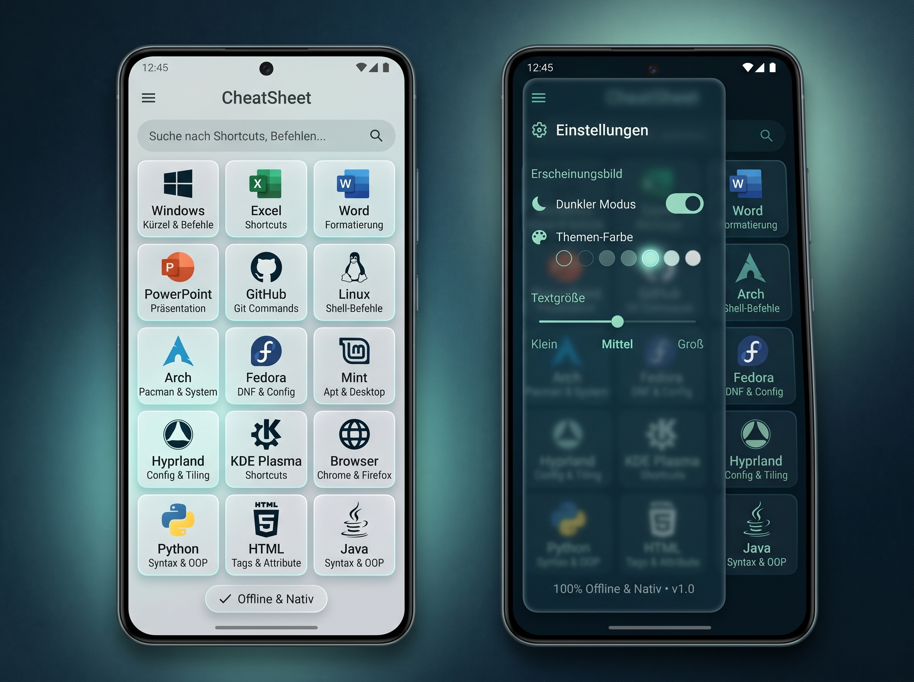

# CheatSheet 🌊⚡
> **100% Native, Offline-First Android CheatSheet & IT Knowledge Base mit echtem Glassmorphismus & 120Hz Support.**



[](https://developer.android.com)
[](https://kotlinlang.org)
[](https://developer.android.com/jetpack/compose)
[](#)
[](#)
[](LICENSE)

---

## 📱 Highlights & Features

- **🛡️ 100 % Nativ & Offline:** Keine Serververbindung, kein Cloud-Zwang, keine Telemetrie, kein Login. Alle **800+ Datensätze** sind sofort lokal verfügbar.
- **⚡ 120Hz High-Refresh-Rate:** Hardwarebeschleunigung (`android:hardwareAccelerated="true"`) und explizite Freischaltung der nativen Display-Bildwiederholrate (`preferredDisplayModeId` / 120Hz) für butterweiches Scrolling.
- **✨ Glassmorphismus (Sturm & Meer-Palette):**
  - **Deep Midnight Blue** (`#09151E`)
  - **Dark Petrol** (`#0B2B36`)
  - **Muted Slate Teal** (`#527276`)
  - **Soft Seafoam Cyan** (`#84B0AE`)
  - **Light Ice Gray** (`#CFD5D7`)
  - 24.dp Squircles, transluzente Oberflächen und 1.dp Lichtkanten-Gradients.
- **🔍 Blitzschnelle Echtzeit-Suche:** Filtert live über alle 21 Kategorien, Sektionen, Befehle und Beschreibungen hinweg.
- **📋 One-Tap Copy:** Jeder Befehl / Shortcut kann mit einer Berührung in die Zwischenablage kopiert werden.
- **⭐ Favoriten-System:** Markiere wichtige Befehle mit dem Stern-Icon – dauerhaft lokal gespeichert via Jetpack DataStore.
- **🎛️ Settings Drawer:**
  - Dark Mode / Light Mode Switch
  - 6-stufiger Akzentfarben-Picker
  - 3-stufiger Textgrößen-Slider (`Klein`, `Mittel`, `Groß`), der die UI responsive mitskaliert.

---

## 📚 Enthaltene Kategorien (800+ Einträge)

| Bereich | Kacheln & Themen | Anzahl Einträge |
| :--- | :--- | :--- |
| **Office & OS** | Windows, Excel, Word, PowerPoint, Browser (Chrome & Firefox) | 157 |
| **Linux & Desktop** | Linux Core, Arch Linux, Fedora, Linux Mint, Hyprland, KDE Plasma | 186 |
| **Dev & Code** | GitHub & Git, Python, HTML5, CSS3, Java | 155 |
| **DevOps & Net** | Bash Scripting, Network & SSH, Docker & Container | 93 |
| **IT-Lexikon** | **TL;DR & Deep-Dive:** Web/Netzwerk, Dev/Architektur, Security, System/DevOps | **104** |
| **Power-Tools** | **Modern CLI, Windows Tools, Linux SysAdmin, Dev & Security** | **105** |
| **Gesamt** | **21 Kategorien** | **800 Datensätze** |

---

## 🏗️ Architektur & Tech-Stack

- **UI Framework:** Jetpack Compose mit Material 3 Theming
- **Architekturmuster:** MVVM (Model-View-ViewModel) mit reaktiven `StateFlow`-Streams
- **Persistence:** `Jetpack DataStore (Preferences)` für Design-Settings & Favoriten-IDs
- **State Management:** Unidirektionaler Datenfluss (UDF) mit Lifecycle-aware State Collection
- **Build System:** Gradle Kotlin DSL (`build.gradle.kts`) mit Version Catalog (`libs.versions.toml`)

```
app/src/main/java/com/example/
├── MainActivity.kt                      # Lifecycle, 120Hz Display-Unlock & Navigation
├── data/
│   ├── model/CheatModels.kt             # Typsichere Datenmodelle & Enums
│   ├── preferences/UserPreferencesRepository.kt # DataStore Persistence
│   └── repository/                      # Modulare, strukturierte Datensätze
│       ├── CheatDataProvider.kt         # Zentraler Registry-Provider
│       ├── OfficeCheatSheets.kt         # Windows, Excel, Word, PPT, Browser
│       ├── LinuxCheatSheets.kt          # Linux, Arch, Fedora, Mint, Hyprland, KDE
│       ├── DevCheatSheets.kt            # Git, Python, HTML, CSS, Java
│       ├── DevOpsCheatSheets.kt         # Bash, SSH/Network, Docker
│       ├── KnowledgeCheatSheets.kt      # 104 IT-Lexikon & TL;DR Einträge
│       └── ToolsCheatSheets.kt          # 105 CLI & Power-Tools Einträge
└── ui/
    ├── components/
    │   ├── GlassCard.kt                 # Glassmorphic Squircle Card (Frosted Look)
    │   ├── CategoryIconRenderer.kt      # Hardware-beschleunigte Canvas-Vektor-Icons
    │   └── SettingsDrawerContent.kt     # Drawer (Dark Mode, Color Picker, Slider)
    ├── screens/
    │   ├── MainHomeScreen.kt            # 3-Spalten Grid, Suchleiste & Filterchips
    │   └── CheatDetailScreen.kt         # Detailansicht, Copy-To-Clipboard, Favoriten
    ├── theme/
    │   ├── Color.kt                     # Sturm- & Ozeanfarbpalette
    │   ├── Type.kt                      # Responsives Typography-Scaling
    │   └── Theme.kt                     # M3 Glassmorphism Theme
    └── viewmodel/
        └── MainViewModel.kt             # Such-Logik, Filterung & Einstellungen
```

---

## 🚀 Bauen & Starten

### Voraussetzungen
- Android Studio Ladybug / Meerkat oder neuer
- JDK 17 oder JDK 21
- Android SDK 36 (Min SDK 24)

### Ausführen über die Kommandozeile
```bash
# Repository klonen
git clone https://github.com/<DEIN-USERNAME>/CheatSheet.git
cd CheatSheet

# Debug-APK kompilieren
./gradlew assembleDebug

# Tests ausführen
./gradlew testDebugUnitTest
```

Die fertige APK liegt anschließend unter:
`app/build/outputs/apk/debug/app-debug.apk`

---

## 📄 Lizenz

Dieses Projekt ist unter der [MIT-Lizenz](LICENSE) lizenziert.
